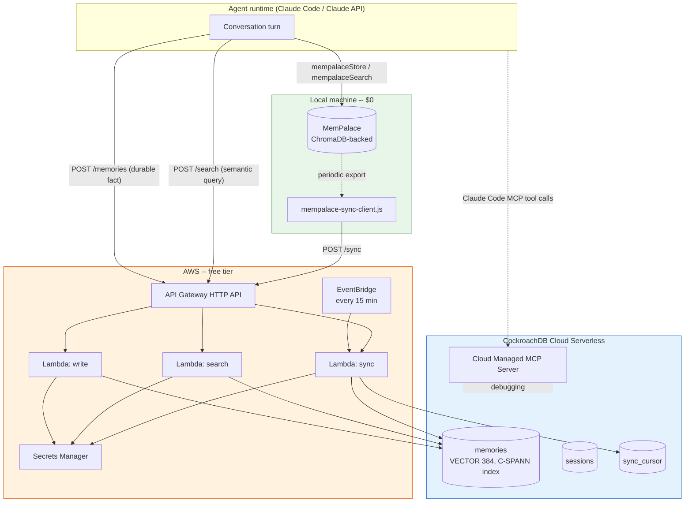

# Architecture

## Design goal

Give an agent two speeds of memory:

1. **Session-fast** — the working set of the current conversation, recalled
   in milliseconds, at zero marginal cost.
2. **Durable and global** — facts, preferences, and decisions that must
   survive a restart, be visible from another device, or be queried across
   a whole user base.

Treating these as one system (either "everything in a vector DB" or
"everything in local memory") means either paying network latency on every
turn, or losing memory the moment a process exits. AgentMemory keeps them as
two systems with one contract: **MemPalace owns recency, CockroachDB owns
durability**, and a sync path keeps them loosely consistent.

## Diagram

## Data flow

1. **Within a session**, the agent calls `mempalaceStore` and
   `mempalaceSearch` directly against the local ChromaDB store. No network
   call, no cost, sub-millisecond recall.
2. **When something durable happens** (a stated preference, a decision, a
   fact worth remembering next week), the agent calls `POST /memories`. The
   `write` Lambda embeds the content locally (no external embedding API) and
   inserts it into CockroachDB's `memories` table.
3. **Cross-session recall** goes through `POST /search`, which embeds the
   query and runs a cosine-distance nearest-neighbor search scoped to
   `(user_id, status='active')` using the C-SPANN vector index.
4. **Periodically** (every 15 minutes via EventBridge, or on demand),
   `mempalace-sync-client.js` exports MemPalace's local memories above a
   salience threshold and posts them to `POST /sync`, which upserts them
   into CockroachDB keyed by `(user_id, mempalace_id)` — idempotent, so a
   retried sync never double-writes.
5. **A new session can "wake up" warm**: `sync/index.js` exposes a `wakeUp`
   query that returns a user's highest-salience CockroachDB memories, which
   MemPalace can seed into its local store instead of starting empty.

## Why CockroachDB specifically (not "any Postgres-compatible DB")

- **Native VECTOR type + C-SPANN distributed vector index** means embeddings
  and transactional data (tags, salience, session linkage) live in one
  table with one consistency model — no separate vector store to keep in
  sync.
- **Prefix-column indexing** (`user_id, status`) gives per-tenant isolation
  and performance for free: the index only accelerates queries that
  constrain every prefix column, which naturally forces every query in this
  app to be scoped to one user.
- **Serverless, multi-region-capable** — the same schema can later be spread
  across regions as the user base grows, without a re-architecture.
- **Managed MCP Server + ccloud CLI** make both the interactive
  (Claude Code, ad-hoc debugging) and scripted (CI, provisioning) paths
  first-class, agent-friendly surfaces.

## Known trade-offs

- MemPalace and CockroachDB are **loosely consistent** — a memory can exist
  locally for up to `sync.interval_minutes` before it's durable. Acceptable
  for preferences/facts; not used for anything safety-critical.
- CockroachDB's vector index currently only accelerates queries that
  constrain every prefix column (`user_id` and `status` here). Any query
  that doesn't specify both falls back to a full scan — by design, that's
  never the access pattern this app needs.
- Lambda-to-CockroachDB connection pooling is intentionally small
  (`PG_POOL_MAX=3` per warm instance) to stay within the Serverless
  free-tier connection budget; a high-traffic deployment would add
  RDS-Proxy-style pooling in front of it.
